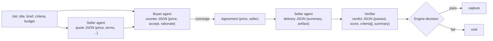

# PACT — AI system

PACT uses a language model for the parts of the workflow that need reading,
judgement, and generation: quoting a price, countering an offer, producing a
deliverable, and verifying it. This document describes the AI integration as it is
actually implemented, and — importantly — what the AI is **not** allowed to do.

## Provider and configuration

PACT talks to **any OpenAI-compatible chat-completions endpoint**. The model is a
deployment choice, not a hard-coded vendor.

| Setting | Meaning | Default |
|---|---|---|
| `LLM_API_KEY` (or `OPENAI_API_KEY`) | Credential for the endpoint | empty |
| `LLM_BASE_URL` | Base URL of the endpoint | `https://api.openai.com/v1` |
| `LLM_MODEL` | Model name | `gpt-4o-mini` |
| `LLM_TEMPERATURE` | Sampling temperature | `0.2` |
| `LLM_TIMEOUT` | Per-request timeout (seconds) | `90` |

The deployed demo runs on Groq's OpenAI-compatible endpoint with
`openai/gpt-oss-20b`; `/api/health` reports `llm.model` and `llm.is_mock: false` for
that deployment.

*Source:* `backend/pact/config.py` (`LLMSettings`), `backend/pact/core/llm.py`
(`OpenAICompatibleLLM`).

## The three AI roles

PACT defines three distinct agent roles, all served by the same client:

| Role | Prompt task tag | What it does |
|---|---|---|
| **Seller** | `seller_offer`, `deliver` | Quotes a price each round, then produces the deliverable |
| **Buyer counter** | `buyer_counter` | Counters each offer; never above the budget |
| **Verifier** | `verify` | Judges the delivery against each acceptance criterion |

The system prompts are in `backend/pact/core/negotiation.py` (`BUYER_SYSTEM`,
`SELLER_SYSTEM`), `backend/pact/agents/seller.py` (`DELIVERER_SYSTEM`), and
`backend/pact/core/settlement.py` (`VERIFIER_SYSTEM`). Each asks for a strict JSON
object with a documented shape.

## Input/output flow

- **Negotiation.** Each seller quotes; the buyer counters; the price converges over
  up to `max_rounds` (default 3). Every turn is recorded in the ledger.
- **Delivery.** The winning seller produces the artifact inline as text.
- **Verification.** The verifier returns a per-criterion verdict with evidence.

## What the AI does NOT do

This is the most important section. **The AI proposes; the engine decides.**

- **The AI cannot authorize or capture a payment.** There is no code path from a
  model response to a PayPal call. The model never sees or supplies a PayPal id, and
  the settlement engine independently decides whether money moves.
- **The AI cannot exceed the budget.** The budget ceiling is enforced in code; an
  agreement above it is rejected by the engine regardless of what the model returns.
- **The AI cannot force a pass.** Verification is a conjunction of deterministic
  checks (artifact present and non-trivial, no evasion markers, a summary present)
  **and** the model's verdict. Failing either one voids the hold.
- **A malformed verdict cannot release funds.** `as_bool` parses strictly and fails
  closed: `"passed": "false"` is `False`; anything unparseable is `False`.
- **The AI is not a trusted input channel.** Its output is treated as untrusted data
  and validated before use.

*Source:* `backend/pact/core/settlement.py` (`Verifier.verify`, the AND of
deterministic and model results), `backend/pact/core/llm.py` (`as_bool`,
`_extract_json`), `backend/pact/core/negotiation.py` (budget enforcement).

## Prompt architecture

The prompts are deliberately narrow and disclose no secrets. Each is a short system
message stating the role, the rules, and the exact JSON shape expected, followed by a
`CONTEXT:{…}` user message carrying only the job fields the role needs (title, brief,
criteria, budget, agreed price, and — for the verifier — the delivery artifact,
truncated to 8000 characters). The prompts contain no credentials, no provider ids,
and no other users' data.

The verifier prompt states the product's core rule in plain terms: it is paid to be
right, a wrong "pass" costs the buyer real money, vague assurances do not satisfy a
criterion, and an empty or evasive artifact must fail.

## Error handling and fallback

- **Retries.** The client retries a small number of times on an empty body or a
  transient `5xx`, because dropping a seller from the market over one hiccup would
  distort the negotiation.
- **JSON extraction.** `_extract_json` accepts a fenced or bare JSON object and
  raises `LLMError` if none can be parsed.
- **Verifier failure.** If the model fails, the verifier records
  `passed=False` with a "model verification unavailable" summary, so a model outage
  fails closed rather than releasing funds.
- **Seller failure.** If the model fails to produce a deliverable, an empty artifact
  is recorded, which the deterministic checks fail.
- **Deterministic fallback (no key).** When `LLM_API_KEY` is unset, PACT uses
  `MockLLM`, a deterministic policy engine, so the whole lifecycle runs end to end
  offline. The UI labels this "Mock agents" and `/api/health` reports
  `llm.is_mock: true`. This exists so a reviewer can clone the repository and see the
  complete lifecycle without signing up for anything; it is clearly labelled and
  never presented as a real model.

*Source:* `backend/pact/core/llm.py` (`MockLLM`, `_extract_json`, retry loop),
`backend/pact/core/settlement.py` (verifier failure handling),
`backend/pact/agents/seller.py` (delivery failure handling).

## API boundaries

The LLM is reached over HTTPS with a bearer token in the `Authorization` header. The
client sends only job-derived text; it sends no PII, no PayPal ids, and no
credentials other than the model API key. The response is parsed as JSON and
validated; a non-JSON or wrongly-shaped response is an error, not a silent default.

## Security considerations

- **Untrusted output.** Model output is data, not instructions. It is validated and
  bounded before it influences any decision.
- **Fail closed.** Every model-driven decision that could move money resolves to the
  conservative outcome when the model is unavailable or malformed.
- **No privilege.** The model has no tools, no network access of its own, and no
  ability to call the PayPal client.
- **Budget guardrail.** The single most important financial guardrail (the budget
  ceiling) does not depend on the model at all.
- **Prompt-injection surface is small.** The model sees only the buyer's own job
  fields and the seller's own delivery; a malicious brief can at most produce a
  bad-but-validated verdict, which the deterministic checks and the AND still gate.

## Related

- How the verdict gates settlement: [`payment-lifecycle.md`](payment-lifecycle.md) (Stage 5–6)
- The settlement engine: [`architecture.md`](architecture.md)
- Machine-readable status: [`metadata/integrations.json`](../metadata/integrations.json)
