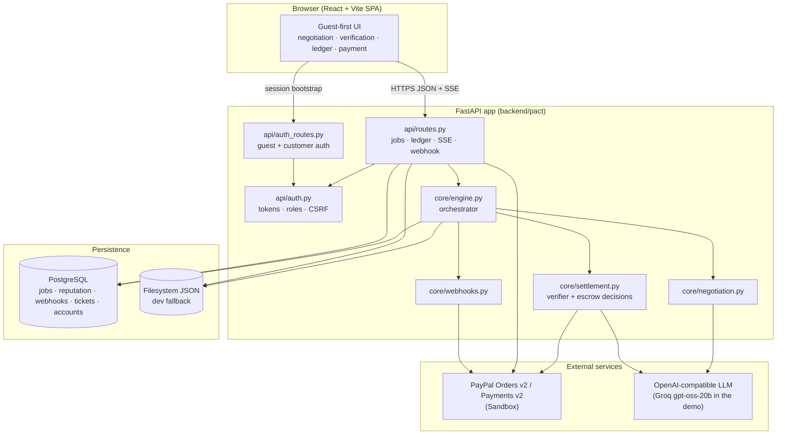
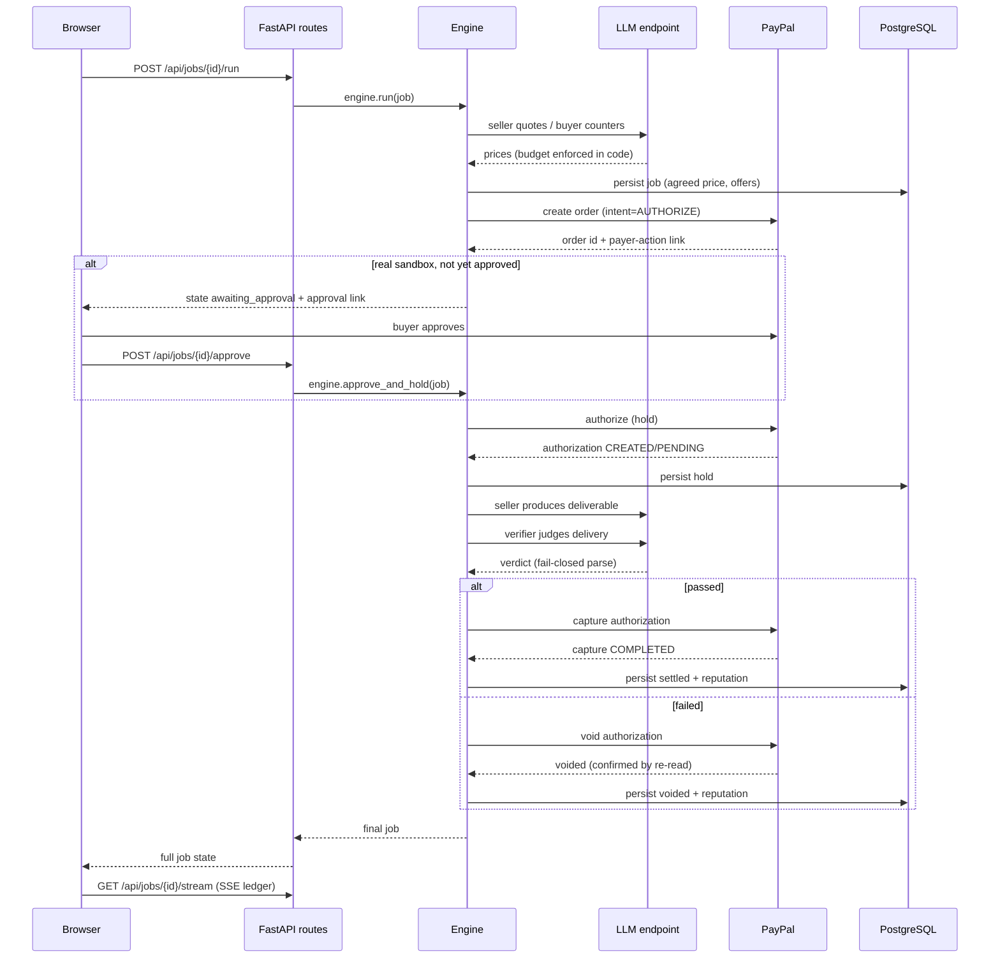
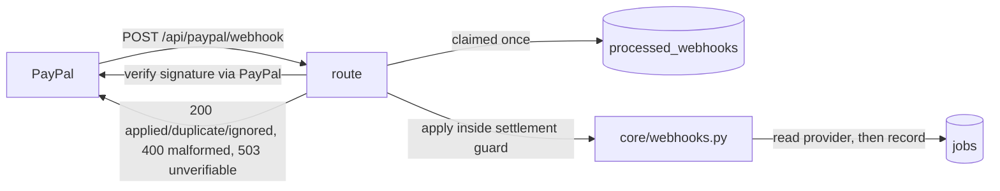
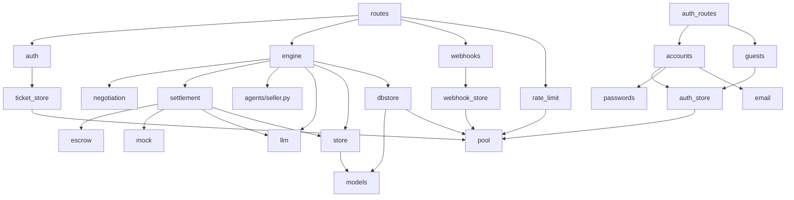

# PACT — architecture

This document describes how PACT is built: the frontend, the backend, the API
surface, the database, the external services, and how they connect. Diagrams use
[Mermaid](https://mermaid.js.org/) and render on GitHub. Every component named here
maps to a file in the repository; see [`metadata/architecture.json`](../metadata/architecture.json)
for the machine-readable map.

## System overview



The same FastAPI app is served two ways: as a Vercel Python function
(`api/index.py` → `pact.main:app`) in production, and as a Docker/uvicorn service
for a single container. In the Docker/self-hosted path the built SPA is mounted at
`/` by the app; on Vercel the SPA is served as static output and the function only
handles `/api/*`.

## Frontend

Location: `frontend/`. React 18 + Vite 6 + Tailwind CSS 3, with AG Grid for the
ledger grid. It is a single-page app; the server serves `index.html` for any
unknown GET path so client-side routes work (`_SPAStaticFiles` in `main.py`).

- **Session bootstrap** (`src/lib/api.js`, `bootstrapSession`): on load the client
  restores or creates a guest session, so the first screen is the working product.
  An operator token, if present in `localStorage`, takes precedence.
- **Credential handling**: a guest session is a cookie the client never sees; the
  matching CSRF token is kept in memory only and echoed on mutating requests. An
  operator bearer token is stored in `localStorage`.
- **Live updates**: `streamJob` subscribes to the job's SSE ledger. Because
  `EventSource` cannot send an `Authorization` header, an operator mints a
  short-lived, single-job *ticket* over a normal request and puts only the ticket in
  the URL; a guest uses the cookie path.
- **Payment honesty** (`src/lib/status.js`, `paymentStatus`): a pure function maps
  the escrow state to a single, conservative reading for the buyer. `settled`
  requires a `released` escrow and a non-simulated capture; anything ambiguous
  resolves to a state that asks for a human (reconcile) rather than claiming success.
- **Components**: `Composer` (post a job), `Negotiation`, `Verification`,
  `PaymentStatus`, `Ledger`, `Reputation`, `Welcome` (first-run orientation), and
  shared `primitives`.

## Backend

Location: `backend/pact/`. FastAPI, Pydantic v2, `sse-starlette` for the event
stream, `httpx` for outbound calls, `PyJWT` for tokens, `argon2-cffi` for password
hashing.

### Entry point and middleware (`main.py`)

- **Request body cap** (`LimitRequestBodyMiddleware`): counts real bytes on the ASGI
  `receive` channel so a chunked body cannot bypass the cap (a `Content-Length`
  check alone is not enough). A body over 64 KiB is rejected with `413`.
- **Response hardening headers** (`SecurityHeadersMiddleware`): the outermost layer
  appends `X-Content-Type-Options`, `X-Frame-Options`, a framing/embedding-only
  `Content-Security-Policy`, `Referrer-Policy`, `Permissions-Policy`,
  `Cross-Origin-Opener-Policy` and `X-Permitted-Cross-Domain-Policies` to every
  response, including errors. The statically-served SPA document gets the same set
  from `vercel.json`. See [ADR 0008](architecture-decisions/0008-application-level-security-headers.md).
- **CORS**: exact origins only, with credentials, so a shared parent domain cannot
  read another tenant's settlement.
- **Routers**: `public_router` (liveness + webhook), `router` (everything that reads
  or moves money, protected by a router-level `require_principal` dependency),
  `stream_router` (SSE, which verifies the token from a query ticket), and the auth
  routers.
- **Startup validation** (`announce_configuration`): runs `settings.validate_runtime()`
  and refuses to start in production on an unsafe configuration; also refuses to
  start if the configured PostgreSQL ticket store could not be opened.
- **Error handling**: a validation error is rendered as a `422` (with non-finite
  floats stringified so the render itself cannot fail); an unhandled exception is a
  logged `500` with a generic body, so internals never leak.

### Orchestrator (`core/engine.py`)

`PactEngine` drives the whole lifecycle in one call:

```
brief → negotiate → agree → hold → deliver → verify → release | void
```

It bounds concurrency with a `BoundedSemaphore` (refusing with `ServerBusy` rather
than queueing without bound) and enforces its own run deadline so a run marks a job
failed rather than being killed mid-flight by the platform.

### Negotiation (`core/negotiation.py`)

Multi-round bargaining between a buyer agent and each seller agent. The budget
ceiling is enforced in code; a convergence guarantee closes an affordable deal even
if the model never emits an explicit acceptance. Seller selection divides price by a
smoothed verified-delivery score (reputation feedback).

### Settlement (`core/settlement.py`)

Two responsibilities:

- **`Verifier`**: deterministic checks (artifact present and non-trivial, no evasion
  markers, a summary present) combined with model judgement by logical AND.
- **`SettlementEngine`**: `hold`, `authorize_hold`, `release` (capture), `refund`
  (void a hold), `refund_capture` (reverse a capture), `cancel`, and `reconcile`.
  Every money transition is serialised on a per-job guard and claims its provider
  object before calling out.

### Escrow client (`paypal/escrow.py`, `paypal/mock.py`)

A hand-written PayPal `Orders v2` / `Payments v2` client. The mock double enforces
the same state machine so the settlement logic under test is the real logic.

### Persistence (`core/store.py`, `core/dbstore.py`, `core/pool.py`)

- **`JobStore`** — filesystem JSON, thread-safe (`threading.RLock`), correct for one
  process.
- **`PostgresJobStore`** — JSONB documents with indexed columns; the settlement claim
  takes a session advisory lock on a *direct* connection and re-reads the
  authoritative row, so two instances cannot both capture the same authorization.
- **`DatabasePool`** — a bounded per-instance connection pool; `direct()` connects to
  the unpooled endpoint for the settlement lock.

### Money-route rate limiting (`core/rate_limit.py`)

A fixed-window limiter guards every money-bearing route. It picks its backend from the
same signal as the ticket and webhook stores: a shared PostgreSQL counter when
`DATABASE_URL` is configured (so the limit is not spent once per instance), and a
process-local counter otherwise (correct for the single-instance deployment that has
no database). A configured-but-unreachable store yields an `unavailable` limiter that
refuses every request. The identity is the signed token subject, or the client address
for a guest or anonymous caller. `GET /api/health` reports the scope.

## API routes

The full reference is [`api/README.md`](api/README.md). Summary:

| Method | Path | Role | Purpose |
|---|---|---|---|
| `GET` | `/api/health` | public | Configuration and settlement mode |
| `POST` | `/api/paypal/webhook` | public (signature) | Apply a verified PayPal event |
| `POST` | `/api/auth/guest` | public | Provision a guest workspace |
| `GET` | `/api/auth/guest` | guest cookie | Report the guest session |
| `POST` | `/api/auth/guest/logout` | public | Clear the guest cookie |
| `POST` | `/api/auth/register` | public (opt-in) | Create a customer account |
| `POST` | `/api/auth/login` | public (opt-in) | Start a customer session |
| `POST` | `/api/auth/refresh` | public (opt-in) | Rotate a refresh token |
| `POST` | `/api/auth/logout` | public (opt-in) | Revoke a refresh family |
| `GET` | `/api/auth/me` | any | Current principal |
| `POST` | `/api/jobs` | buyer | Post a job |
| `GET` | `/api/jobs` | any | List visible jobs |
| `GET` | `/api/jobs/{id}` | owner | Full job state |
| `POST` | `/api/jobs/{id}/run` | owner buyer | Run the full lifecycle |
| `POST` | `/api/jobs/{id}/approve` | owner buyer | Continue after buyer approval |
| `POST` | `/api/jobs/{id}/cancel` | owner buyer | Void a hold so the job can be deleted |
| `POST` | `/api/jobs/{id}/refund` | owner buyer | Refund a captured payment |
| `POST` | `/api/jobs/{id}/reconcile` | admin | Resolve an `unresolved` job |
| `DELETE` | `/api/jobs/{id}` | admin | Tombstone a fully resolved job |
| `GET` | `/api/jobs/{id}/ledger` | owner | Audit trail + chain validity |
| `POST` | `/api/jobs/{id}/stream-ticket` | owner | Mint a single-job SSE ticket |
| `GET` | `/api/jobs/{id}/stream` | owner | Server-sent events |
| `GET` | `/api/jobs/{id}/paypal-order` | admin | Provider order record (redacted) |
| `GET` | `/api/reputation` | any | Agent reputation |
| `GET` | `/api/ledger` | any (scoped) | Settlement decisions visible to the caller |

## Data flow: one run



## Webhook subsystem



A webhook is a *notification, not an instruction*: it never moves money on its own.
The route refuses an unverifiable event (`401`), a malformed body (`400`), and a
missing shared store (`503`), and applies an event at most once.

## Session management

- **Guest sessions**: a server-provisioned buyer identity; the session token is a
  JWT carrying the account's `token_version`, delivered as an `HttpOnly`,
  `SameSite=Lax` cookie scoped to `/api`; mutating requests must echo the CSRF token.
- **Operator tokens**: HS256 JWTs minted by `scripts/issue_token.py`, sent as an
  `Authorization: Bearer` header; not reachable cross-origin by a browser, so no CSRF
  token is required.
- **Customer sessions** (opt-in): short-lived access tokens plus rotating refresh
  tokens; reuse of a refresh token revokes the whole family.
- **Stream tickets**: a single-use, 60-second, single-job capability that lets an
  `EventSource` authenticate without putting a real token in a URL.

## Component relationships



## Related

- Payment stages in detail: [`payment-lifecycle.md`](payment-lifecycle.md)
- Database schema: [`database.md`](database.md)
- Security controls: [`security.md`](security.md)
- AI roles: [`ai-system.md`](ai-system.md)
- Why the escrow client is hand-written: [`architecture-decisions/0001-hand-written-paypal-client.md`](architecture-decisions/0001-hand-written-paypal-client.md)
