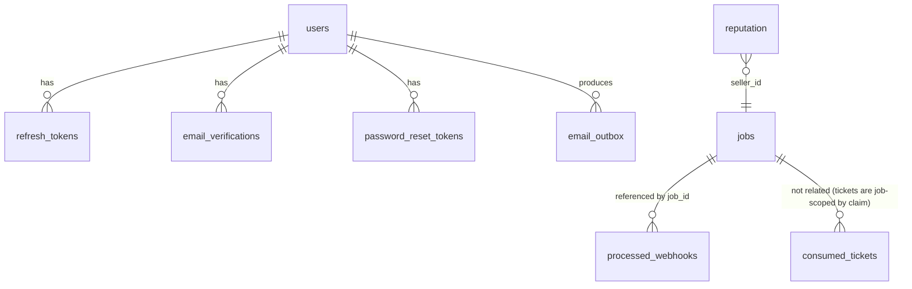

# PACT — database

PACT stores its durable state in **PostgreSQL**. A filesystem store is used for
single-instance development, but production requires PostgreSQL because a
serverless deployment runs many instances and has no durable local disk. This
document describes the schema, the migrations, how guest sessions are isolated, the
integrity guarantees, and the retention behaviour.

No real production data is reproduced here; only the schema and its purpose.

## Provider and configuration

- **Setting:** `DATABASE_URL` — the application (pooled) connection string.
- **Setting:** `DATABASE_URL_UNPOOLED` — the direct endpoint for the settlement
  session lock (see below). Optional; derived from a Neon-style `-pooler` host when
  unset.
- **Driver:** `psycopg` 3 with `psycopg_pool` (bounded per-instance pool).
- **Pool sizing:** `PACT_PG_POOL_MAX_SIZE` (default 5) is a *per-instance* cap. The
  fleet's worst case is `active instances × max_size`; budget it against the database
  plan.
- **Statement timeout:** applied with `SET LOCAL` inside a transaction per checkout
  (`PACT_PG_STATEMENT_TIMEOUT_MS`), never as a libpq startup parameter, because a
  managed pooler rejects that and every connection would fail.
- **Prepared statements:** psycopg3's automatic server-side preparation is
  **disabled** (`PACT_PG_PREPARE_THRESHOLD=none`) on every pooled connection. Behind
  a transaction-mode pooler the pooler hands the same server connection to a
  different client between transactions; a statement prepared by one client (`_pg3_0`)
  then collides with the next client's identically named one and raises
  `DuplicatePreparedStatement`. Set a positive integer only for an endpoint you know
  is a direct session.

When `DATABASE_URL` is unset, the stores fall back to the filesystem
(`PACT_DATA_DIR`). Production startup refuses to run without a database (see
[`deployment.md`](deployment.md)).

## Tables

### Core settlement tables (`core/dbstore.py`)

**`jobs`** — one row per job. The full job document is stored as JSONB (`doc`);
a few columns are denormalised for filtering and ordering.

| Column | Type | Purpose |
|---|---|---|
| `id` | `TEXT PRIMARY KEY` | Job id (`job_…`) |
| `created_at` | `TIMESTAMPTZ NOT NULL` | Creation time (ordering) |
| `updated_at` | `TIMESTAMPTZ NOT NULL` | Last write |
| `status` | `TEXT NOT NULL` | Job status (indexed) |
| `escrow_state` | `TEXT NOT NULL` | Escrow state |
| `escrow_capture_id` | `TEXT NOT NULL DEFAULT ''` | Capture id, for settlement claims |
| `buyer_id` | `TEXT NOT NULL DEFAULT ''` | Owner (added in a migration) |
| `deleted_at` | `TIMESTAMPTZ` | Soft-delete tombstone |
| `run_lease_expires_at` | `TIMESTAMPTZ` | Execution lease |
| `approval_claimed_at` | `TIMESTAMPTZ` | Buyer-approval claim |
| `doc` | `JSONB NOT NULL` | The full `Job` document |

Indexes: `jobs_created_at_idx`, `jobs_status_idx`, `jobs_buyer_id_idx`,
`jobs_doc_gin_idx` (GIN on `doc` for the seller containment test),
`jobs_seller_id_idx` (expression index on `doc->>'seller_id'`).

**`reputation`** — the agent reputation ledger.

| Column | Type | Purpose |
|---|---|---|
| `agent_id` | `TEXT PRIMARY KEY` | Seller id |
| `doc` | `JSONB NOT NULL` | Counters and derived score |

### Webhook event registry (`core/webhook_store.py`)

**`processed_webhooks`** — exactly-once processing of PayPal events.

| Column | Type | Purpose |
|---|---|---|
| `event_id` | `TEXT PRIMARY KEY` | PayPal event id (the claim) |
| `event_type` | `TEXT NOT NULL` | e.g. `PAYMENT.CAPTURE.COMPLETED` |
| `job_id` | `TEXT` | The PACT job, if the event named one |
| `received_at` | `TIMESTAMPTZ NOT NULL DEFAULT now()` | For retention |
| `processed_at` | `TIMESTAMPTZ` | When it was applied |
| `outcome` | `TEXT NOT NULL DEFAULT 'received'` | Applied/duplicate/ignored |

The primary key on `event_id` makes the claim a single atomic
`INSERT … ON CONFLICT DO NOTHING RETURNING`, so two instances cannot both apply a
redelivery. Only the event id, type, and job id are persisted — never the raw body,
which can carry payer identity.

### SSE ticket registry (`core/ticket_store.py`)

**`consumed_tickets`** — single-use SSE stream tickets.

| Column | Type | Purpose |
|---|---|---|
| `jti` | `TEXT PRIMARY KEY` | Ticket id |
| `expires_at` | `TIMESTAMPTZ NOT NULL` | Indexed, for bounded pruning |

Consumption is one statement (`INSERT … ON CONFLICT … RETURNING`), so a captured
ticket cannot be replayed against another instance.

### Customer accounts (`core/auth_store.py`)

Present but only used when the optional customer-auth subsystem is enabled.

| Table | Purpose |
|---|---|
| `users` | Accounts (including guest identities), unique email, `token_version` for revocation, `status` |
| `email_verifications` | Single-use email verification tokens (hashed) |
| `password_reset_tokens` | Single-use password reset tokens (hashed) |
| `refresh_tokens` | Rotating refresh tokens with a `family_id` for reuse detection |
| `login_attempts` | Rate-limit and lockout counters |
| `email_outbox` | Crash-safe transactional email queue with leases and idempotency keys |
| `auth_events` | Audit log of auth actions |

Token values are stored **hashed**, never in the clear.

## Relationships

Note: `processed_webhooks.job_id` is a soft reference (the event may name a job PACT
does not know). There are no foreign-key constraints, so a tombstoned job does not
block a webhook row from being written.

## Migrations

Migrations are **additive and idempotent**, applied at startup:

- `CREATE TABLE IF NOT EXISTS` creates the original columns only.
- A `MIGRATIONS` tuple then runs `ALTER TABLE … ADD COLUMN IF NOT EXISTS` and
  `CREATE INDEX IF NOT EXISTS` statements, in order, *before* any statement that
  references the new columns.

This ordering matters: a table-wide index on a column an older database does not yet
have would fail at startup before the migration that adds it could run. Each
statement is safe to run on every boot, so there is no separate migration step and
no schema-version table for the core store.

## Transaction records

Each job carries an append-only `ledger` of `LedgerEntry` records inside its JSONB
document. Each entry stores the SHA-256 hash of the previous entry (`prev_hash`) and
its own `hash`, computed over a canonical JSON serialisation of its fields.
`Job.verify_chain()` recomputes the chain; any edit to history breaks it. The ledger
is the transaction record: it names the PayPal order, authorization, capture, and
refund ids, and the reason for each transition.

## Guest-session isolation

A guest is an ordinary `buyer` principal stored in the `users` table under a
reserved, non-deliverable domain (`…@guest.pact.local`). Isolation is **inherited**,
not bolted on: every job query is filtered by `buyer_id` (or by party membership for
a seller), so a guest can only see its own records. A guest is never an `admin` and
cannot reach operator routes. Guest accounts are created verified and active because
the identity was minted by the server, not claimed by a person.

## Data integrity

- **Settlement claims** take a session advisory lock keyed by a stable digest of the
  job id (`_lock_key`), computed with SHA-256 rather than the salted builtin `hash`,
  so two instances compute the same key. The lock is held on a **direct** connection
  (`DatabasePool.direct`), never through a transaction-mode pooler, and the
  authoritative row is re-read inside the lock.
- **Run and approval claims** are single conditional `UPDATE … WHERE …` statements,
  so the reclaim is decided by one statement rather than a read-then-write race.
- **Idempotent writes** for webhook and ticket consumption rely on primary-key
  uniqueness.
- **Fail closed**: a configured-but-unreachable shared store refuses every operation
  rather than falling back to a process-local registry no other instance can see.

## Persistence guarantees

- With PostgreSQL: durable across restarts and shared across instances
  (`/api/health` reports `storage.backend: postgres`, `durable: true`).
- With the filesystem store: durable only for a single container with a mounted
  volume; `/api/health` reports `backend: filesystem`. If the configured data
  directory is not writable, the store falls back to a temporary directory and
  `durable` stays **false**, so nothing claims the ledger will survive a restart.

## Retention

- **Webhook events** (`processed_webhooks`): retained `RETENTION_DAYS = 30` so a
  delayed redelivery is still recognised as a duplicate, then pruned in bounded
  batches (`CLEANUP_BATCH = 500`) with `FOR UPDATE SKIP LOCKED`.
- **Consumed tickets** (`consumed_tickets`): retained only for the ticket's
  remaining lifetime (60 seconds), pruned by an indexed range scan.
- **Jobs**: retained indefinitely (including tombstoned jobs, so a live PayPal
  authorization is never silently discarded). Deletion is a soft-delete tombstone
  set only once the escrow is terminal.
- **Auth tables**: pruned via `store.prune(table, limit)` with bounded batches.

## Related

- What writes each table: [`payment-lifecycle.md`](payment-lifecycle.md)
- Multi-instance analysis: [`TOPOLOGY.md`](TOPOLOGY.md)
- Deployment configuration: [`deployment.md`](deployment.md)
