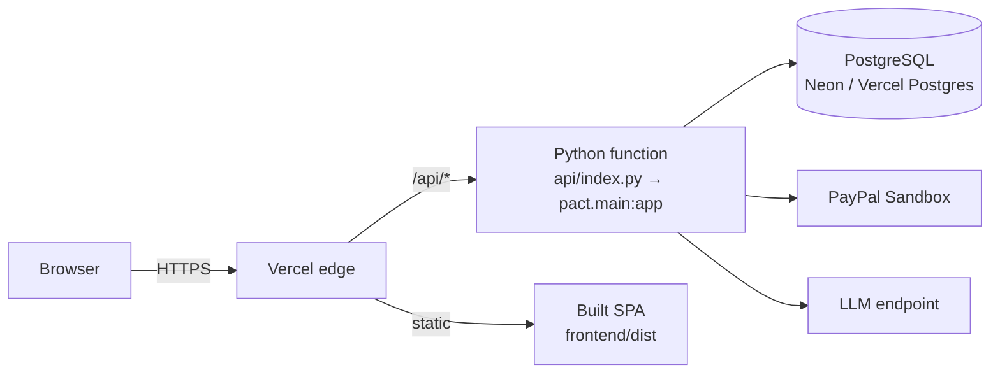

# PACT — deployment

This document explains how PACT is deployed, the configuration it requires, and how
to verify a deployment. It never publishes a secret value; every credential is named
but left empty.

- **Live deployment:** <https://pact-flame.vercel.app/>
- **Health endpoint:** <https://pact-flame.vercel.app/api/health>

## Deployment architecture



Two deployment targets are configured in the repository:

| Target | How it runs | Notes |
|---|---|---|
| **Vercel** (production) | `vercel.json` builds the frontend and routes `/api/*` to the FastAPI function in `api/index.py`; the SPA is served as static output | Serverless, many instances; requires PostgreSQL |
| **Docker / Render** | `Dockerfile` builds the frontend and serves it from `uvicorn pact.main:app`; `render.yaml` runs it as one web service with a 1 GB disk at `/data` | Single container; a filesystem store is acceptable here |

The production deployment is Vercel. `docs/TOPOLOGY.md` analyses the multi-instance
guarantees that serverless requires.

## Vercel configuration

`vercel.json` (repository root):

- `framework: null` — the project supplies its own build and output.
- `installCommand: npm --prefix frontend ci` — reproducible frontend install.
- `buildCommand: npm --prefix frontend run build` — builds the SPA to `frontend/dist`.
- `outputDirectory: frontend/dist`.
- `functions["api/index.py"]` — memory 1024 MB, `maxDuration` 60 s, `includeFiles:
  backend/**` so the function ships with the backend package.
- `rewrites` — `/api/(.*)` → `/api/index`; every other path → `/index.html` (SPA).

`api/index.py` puts `backend/` on the import path and exports the ASGI `app`. No
application code is duplicated for the platform.

## Database configuration

Production **requires** PostgreSQL. Set `DATABASE_URL` to a pooled connection string
(Vercel Postgres, Neon, Supabase, and so on). The application creates its tables on
first use, so there is no separate migration step.

The settlement lock needs a *direct* (unpooled) endpoint. Set `DATABASE_URL_UNPOOLED`
if your provider's pooler host does not carry a recognizable label; on Neon the direct
host is derived from the pooled host automatically. `pool.direct()` verifies the
endpoint with a live probe and refuses one that behaves like a pooler.

## Environment variables

Set these in the Vercel dashboard (Settings → Environment Variables) or the platform's
secret store. Names only; see [`.env.example`](../.env.example) for the full annotated
list.

### Required in production

| Variable | Purpose |
|---|---|
| `PACT_AUTH_SECRET` | HS256 signing key for bearer tokens. Missing → refuse to start. |
| `DATABASE_URL` | Shared PostgreSQL connection string. Missing → refuse to start. |
| `PACT_ENV` | `production` (any value other than `development`/`test` is production) |

### Required for real sandbox settlement

| Variable | Purpose |
|---|---|
| `PAYPAL_CLIENT_ID` | PayPal Sandbox app client id |
| `PAYPAL_CLIENT_SECRET` | PayPal Sandbox app secret |
| `PAYPAL_ENVIRONMENT` | `sandbox` (the only value the demo should use) |

### Optional but used by the demo

| Variable | Purpose |
|---|---|
| `LLM_API_KEY` | LLM credential; without it the deterministic mock runs |
| `LLM_BASE_URL` | LLM endpoint (default `https://api.openai.com/v1`) |
| `LLM_MODEL` | Model name |
| `PACT_GUEST_SESSIONS` | `true` to enable guest sessions (the public demo uses this) |
| `PAYPAL_SANDBOX_BUYER_EMAIL` / `_PASSWORD` | A sandbox buyer account surfaced to guests so they can approve the order |
| `PACT_PUBLIC_URL` | Canonical public origin for PayPal return URLs |
| `PACT_ALLOWED_HOSTS` | Hosts the API may be reached on (forged-Host guard) |
| `PACT_CORS_ORIGINS` | Allowed browser origins |
| `PACT_CURRENCY` | Settlement currency (default USD) |
| `PACT_SELLERS` | Seller agent ids |

### Safety switches

| Variable | Effect |
|---|---|
| `PACT_ALLOW_MOCK_PAYPAL` | `true` permits the in-memory double. Refused in production unless explicitly set and no credentials exist (which is itself flagged). |
| `PACT_REQUIRE_REAL_PAYPAL` | `true` makes missing credentials a hard startup failure |
| `PACT_PAYPAL_SANDBOX_ONLY` | `true` hard-refuses a live PayPal host in every environment |
| `PACT_MAX_CONCURRENT_RUNS` | Concurrent-run ceiling per instance |
| `PACT_RUN_TIMEOUT_SECONDS` / `PACT_LEASE_SECONDS` | Run deadline and execution lease |
| `PACT_PG_POOL_MAX_SIZE` | Per-instance pool size (default 5) |
| `PACT_PG_POOL_MIN_SIZE` | Connections kept open per instance (default 0) |
| `PACT_PG_POOL_TIMEOUT_SECONDS` | Seconds a caller waits for a pooled connection (default 5.0) |
| `PACT_PG_POOL_MAX_IDLE_SECONDS` | Recycle a connection idle longer than this (default 300) |
| `PACT_PG_STATEMENT_TIMEOUT_MS` | Server-side statement timeout; 0 leaves the server default (default 10000) |
| `PACT_PG_PREPARE_THRESHOLD` | psycopg3 statement-preparation threshold; `none` (default) disables it, required behind a transaction-mode pooler |

**Never set `PAYPAL_ENVIRONMENT=live`.** Startup refuses guest sessions against a live
host, and `PACT_PAYPAL_SANDBOX_ONLY` refuses a live host outright.

## Build process

1. **Frontend:** `npm --prefix frontend ci` then `npm --prefix frontend run build`
   (Vite) → `frontend/dist`.
2. **Function:** Vercel's Python runtime installs from the root `pyproject.toml`
   (via `uv.lock`) and packages `backend/**` with `api/index.py`.
3. The root `pyproject.toml`, `requirements.txt`, and `backend/pyproject.toml` must
   declare the same runtime dependencies; CI asserts they agree (a past outage was
   caused by a dependency declared in one manifest but missing from another).

## Health checks

`GET /api/health` is public and is the deployment's health probe. A healthy
production deployment reports:

```json
{ "status": "ok", "paypal": { "mode": "sandbox" }, "llm": { "is_mock": false }, "storage": { "backend": "postgres", "durable": true } }
```

- `status: degraded` means the durable store could not be opened; settlement is
  disabled and `storage.error` carries a fixed classification.
- `storage.backend: postgres` and `storage.durable: true` confirm the multi-instance
  path is in use.
- `llm.is_mock: true` means no model key is configured.
- `paypal.settlement_is_real: false` means the mock is in use (no money moves).

`render.yaml` uses `/api/health` as its health-check path.

## Deployment verification

```bash
curl -s https://<deployment>/api/health | jq '{status, paypal: .paypal.mode, llm: .llm.is_mock, storage}'
```

Expect `status: "ok"`, `paypal: "sandbox"`, `llm: false`,
`storage: {backend: "postgres", durable: true}` for the reference deployment.

Also confirm the app loads (SPA at `/`) and that an unauthenticated money route is
refused:

```bash
curl -s -o /dev/null -w "%{http_code}\n" https://<deployment>/api/jobs   # 401
```

## Rollback considerations

- **Application code:** Vercel keeps prior deployments; promote a previous deployment
  to roll back. No database migration is versioned, so a rollback does not need a
  down-migration (all migrations are additive and idempotent).
- **Schema:** because migrations are additive (`ADD COLUMN IF NOT EXISTS`,
  `CREATE INDEX IF NOT EXISTS`), rolling back the code does not require undoing a
  schema change; an older build simply ignores columns it does not use.
- **Data:** the ledger is append-only per job; a rollback does not rewrite history.
  A job left `unresolved` by an outage is reconciled forward, never rolled back.
- **Secrets:** rotating `PACT_AUTH_SECRET` invalidates every outstanding bearer
  token (clients must re-mint); guest sessions are re-provisioned on next visit.

## Related

- Multi-instance safety: [`TOPOLOGY.md`](TOPOLOGY.md)
- Database schema and migrations: [`database.md`](database.md)
- Security controls: [`security.md`](security.md)
- Local setup: [`development.md`](development.md)
