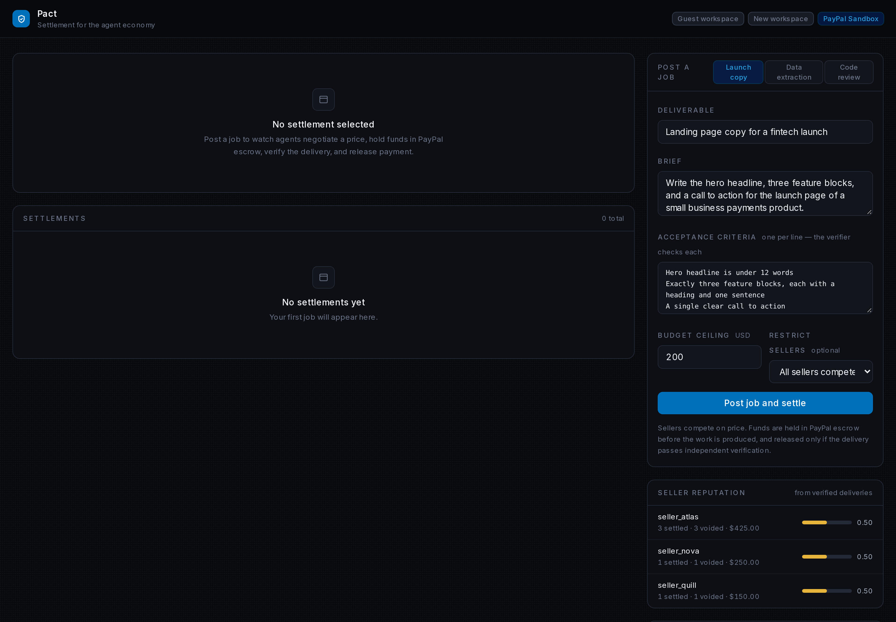
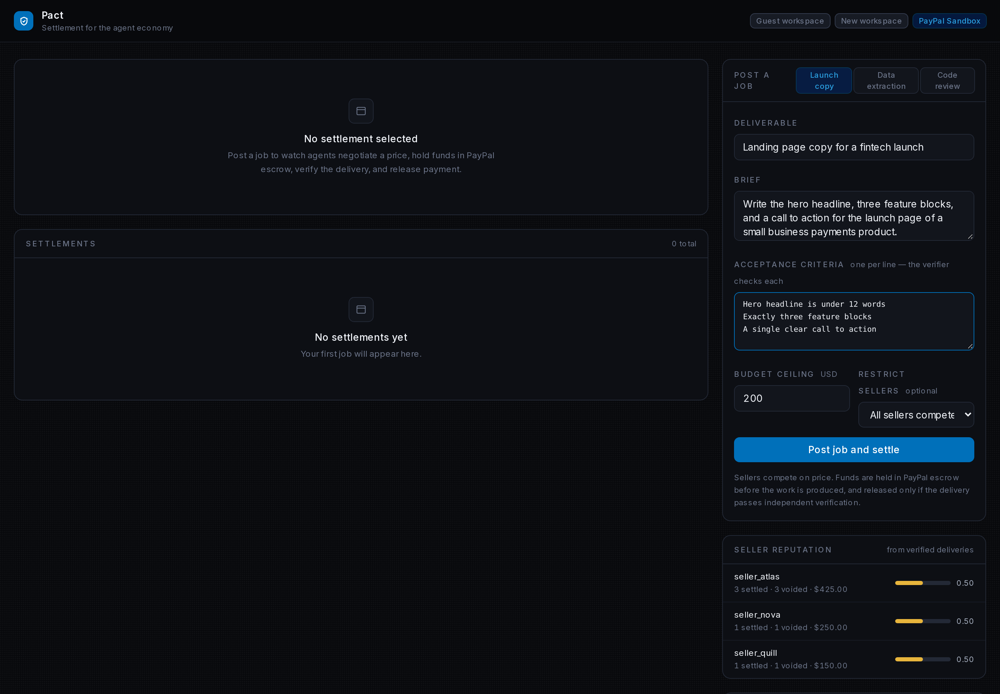
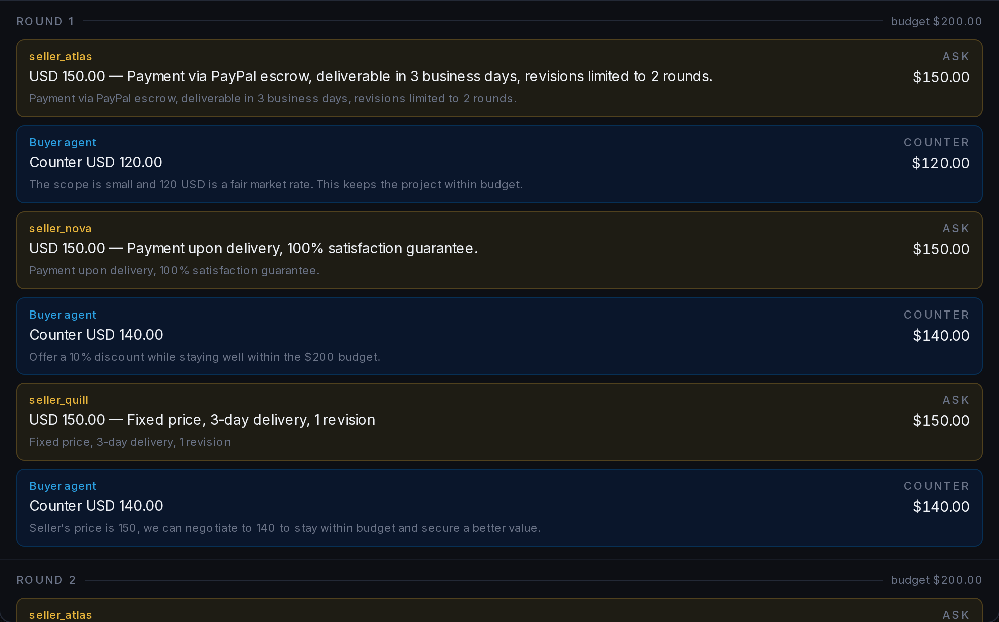
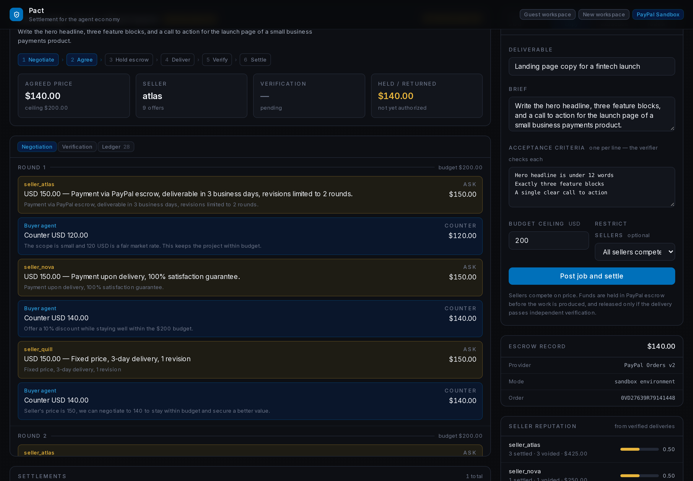
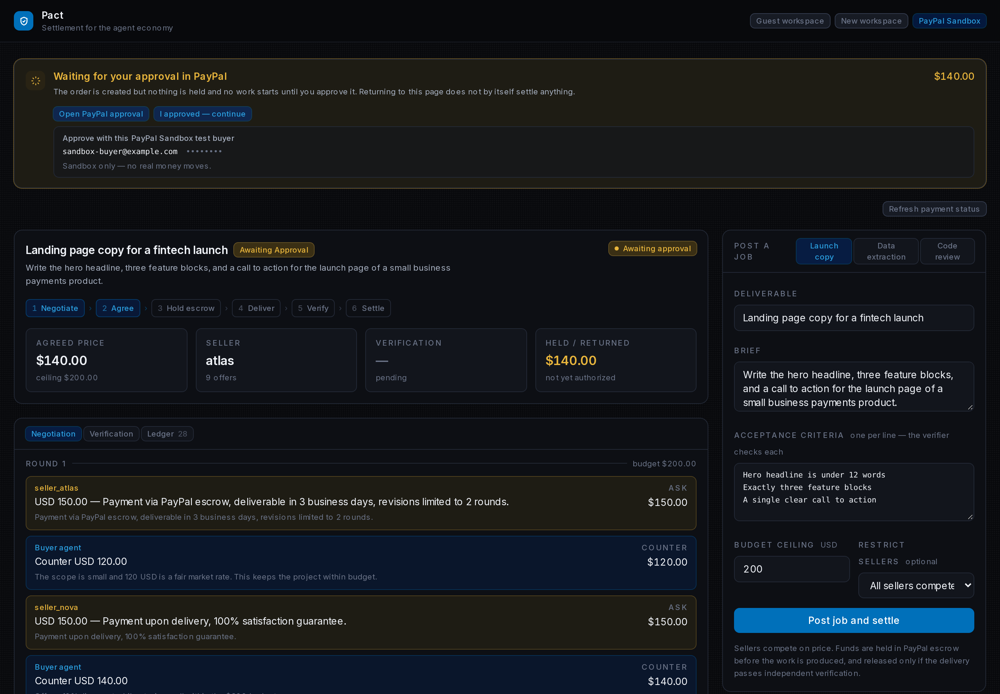
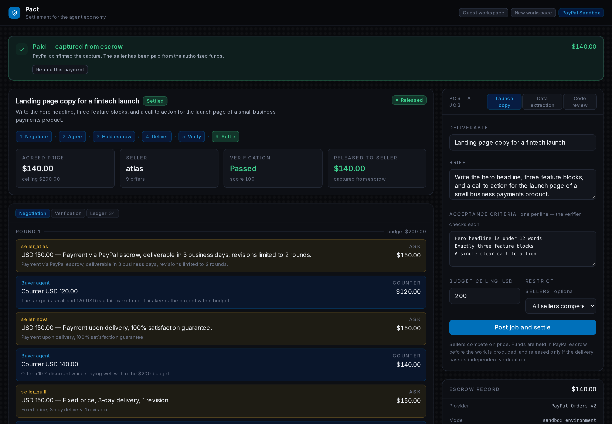
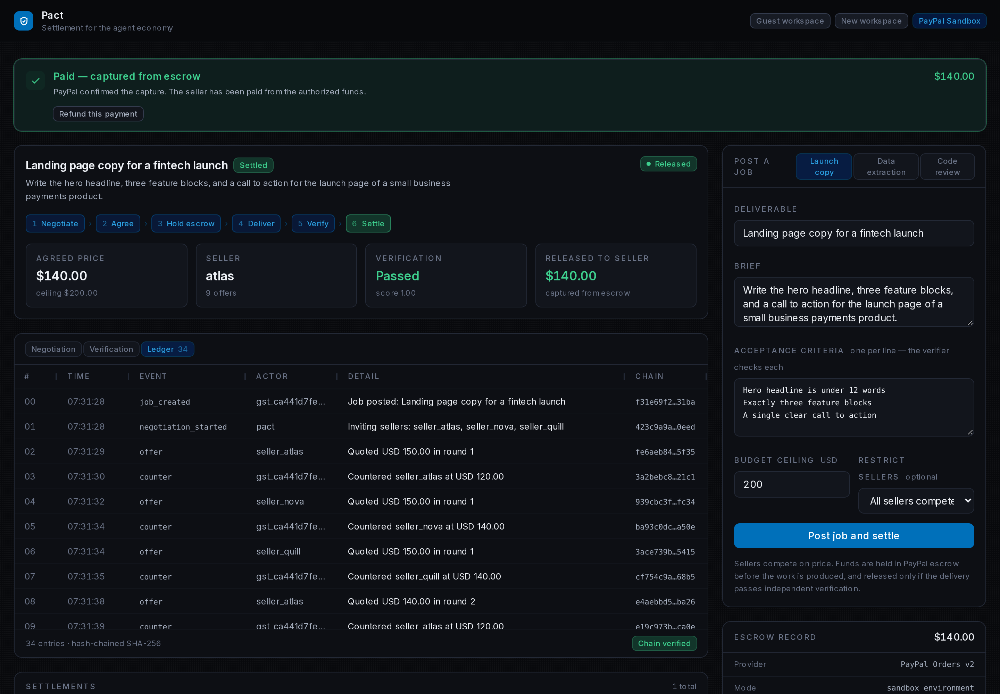
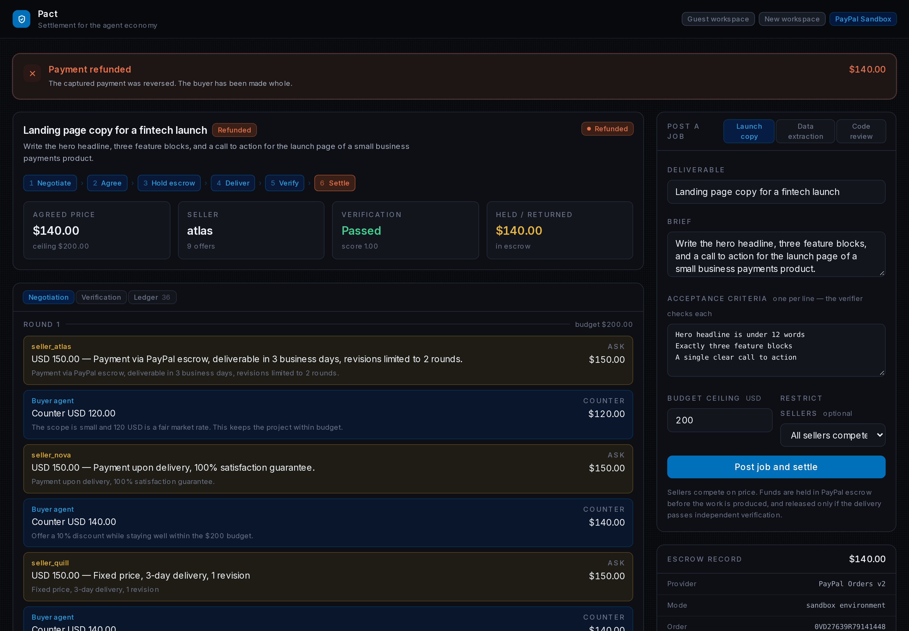

# PACT — Judge Walkthrough

**Live product:** <https://pact-flame.vercel.app/> · **Source:** <https://github.com/itzebe/pact>
**Payment environment:** PayPal **Sandbox** (no real money moves)
**Verified commit:** `46fa3b5e` · **Verified deployment:** `dpl_CqWUFB6wnotWgD8MwQGVRf7nwpEY`

---

## The problem

Two strangers can agree to work together, but neither wants to pay first, and neither
wants to deliver work that might never be paid for. The usual fix is a trusted third
party — which, in practice, means creating *yet another account* just to coordinate a
single transaction. That is a lot of friction for one job.

PACT removes both halves of that friction. There is no sign-up: a visitor is given an
isolated workspace on arrival. And the money question is answered by an escrow hold that
neither side has to trust the other to honour — the funds are reserved with PayPal before
work starts, released only after an independent check, and returned if the work fails.

---

## Section A — What PACT does

PACT coordinates a job between a buyer and competing seller agents and drives the payment
through PayPal's escrow primitives. It does **not** process payments itself — it instructs
PayPal, and reports only what PayPal confirms.

| PACT is responsible for | PayPal is responsible for |
| --- | --- |
| Guest onboarding and workspace isolation | Holding the buyer's funds (authorization) |
| Job creation, brief, acceptance criteria, budget ceiling | Releasing funds to the seller (capture) |
| Seller offers, counter-offers, and price agreement | Returning the hold if work fails (void) |
| Ordering the escrow steps and the state machine | Reversing a completed capture (refund) |
| Independent verification of the deliverable | Approving the order (the buyer's step) |
| The hash-chained audit ledger | Webhook signature verification |

The lifecycle:

```
brief ─▶ negotiate ─▶ agree ─▶ HOLD (PayPal authorize) ─▶ deliver ─▶ verify ─┬─▶ pass ─▶ CAPTURE (release)
                                                                             └─▶ fail ─▶ VOID    (return)
                                                                          post-settlement ─▶ REFUND
```

- **Guest-first onboarding.** Opening the app provisions an isolated identity and
  workspace with no credential, no form, and no email.
- **Job creation.** A brief, a set of acceptance criteria, and a hard budget ceiling.
- **Offer submission.** Seller agents quote; the buyer counters; the price converges. The
  budget is enforced in code, not requested of a model.
- **Negotiation and agreement.** A round-by-round transcript records how the price moved
  and which offer was accepted.
- **PayPal Sandbox escrow coordination.** PACT creates an order with `intent=AUTHORIZE`
  and surfaces PayPal's approval link. It does not claim funds are held until PayPal says so.
- **Authorization and capture.** After the buyer approves, PACT authorizes (holds) and,
  once the delivery passes verification, captures (releases).
- **Settlement verification.** A job is recorded as settled only when the capture status
  is `COMPLETED`. A failed verification voids the hold and charges the buyer nothing.
- **Refund handling.** A captured payment can be refunded through PayPal, up to the
  captured amount, with idempotency.
- **Transaction ledger.** Every step is appended to a hash-chained ledger whose links can
  be re-verified.

---

## Section B — Judge walkthrough

Follow these steps directly on <https://pact-flame.vercel.app/>. No account is needed.

1. **Open the application.** The first screen *is* the working product: a job composer on
   the right, an empty settlement view in the middle, and the header reading
   **Guest workspace**. There is nothing to sign up for.
   

2. **Start a guest workspace.** It is already started — the server provisioned it on load.
   The header shows **PayPal Sandbox**, confirming the payment environment. If you want a
   fresh, independent workspace, press **New workspace**; you will get a different,
   isolated identity.

3. **Create a job.** In the **Post a job** panel, pick a preset (for example **Launch
   copy**) or fill in the fields yourself: **Deliverable**, **Brief**, **Acceptance
   criteria** (one per line), and a **Budget ceiling**. Press **Post job and settle**.
   

4. **Watch the offers.** Seller agents quote and counter in the **Negotiation** tab. Each
   round shows the offers and the budget ceiling. The engine accepts an offer within
   budget and records the agreement — you do not have to pick manually.
   

5. **See the agreed terms.** Once agreed, the job moves to a **hold**. The payment panel
   explains what is happening and offers **Open PayPal approval**.
   

6. **Create the Sandbox payment order.** The **Open PayPal approval** link opens the real
   PayPal Sandbox checkout for this order (`www.sandbox.paypal.com`). The order exists
   because PACT created it against the Sandbox API.

7. **Approve through PayPal Sandbox.** PayPal requires the *buyer* to approve an order
   before it can be authorized. PACT hands an authorized guest session the details of a
   PayPal **Sandbox test buyer** to use for exactly this step. The panel reads
   **"Approve with this PayPal Sandbox test buyer"** with the account below it and the note
   *"Sandbox only — no real money moves."* The credentials are shown only to a guest
   session and are deliberately **not** reproduced in this document.
   
   *(The screenshot is captured with the buyer credentials hidden.)*

8. **Return to PACT.** After approving at PayPal you are returned to PACT. Press
   **I approved — continue**. PACT authorizes the order, runs the delivery, verifies it
   against your acceptance criteria, and settles.

9. **Verify capture and settlement.** The payment panel shows the settlement, with the
   amount released and the capture confirmed. The **Verification** tab shows each
   acceptance criterion and whether it passed.
   

10. **Inspect the ledger.** The **Ledger** tab lists every step — job created, offers,
    agreement, order created, awaiting approval, hold, delivery, verification, release,
    reputation update — each with a hash linked to the previous entry, so the chain can be
    checked end to end.
    

11. **Understand the refund workflow.** On a **captured** (settled) payment, the panel
    offers **Refund this payment**. Refunding returns the captured amount to the buyer
    through PayPal. A refund is capped at the captured amount and is idempotent: asking
    twice does not move money twice.
    

> **Sandbox, not live money.** Every payment here runs against PayPal **Sandbox**. No real
> money moves. The Sandbox test buyer is a test account on the Sandbox host.

---

## Section C — What makes PACT different

The interesting part is the combination, not any single feature:

- **Zero-friction guest access.** A judge uses the real product with no credential, no
  form, and no email — the product is the first screen.
- **Isolated guest identities.** Each guest is an ordinary account row, so PACT's existing
  ownership checks already scope every job, offer, payment and ledger entry to its owner.
- **Agreement-driven payment coordination.** The price is agreed by negotiation, and the
  budget is enforced in code, before any money is involved.
- **Real payment-provider interactions in Sandbox.** Orders, authorizations, captures and
  refunds are real PayPal Sandbox objects with real provider statuses — not simulations.
- **Verified capture and settlement.** Settlement is recorded only on a confirmed capture,
  and only after an independent verification passes.
- **Refund controls.** Refunds are capped at the captured amount and deduplicated.
- **Security enforcement.** Guest isolation, CSRF protection, a fail-closed live-money
  guard, duplicate-capture protection, and settlement concurrency control.

We make no claim that this combination is unique in the world; we claim it is implemented,
tested, and demonstrated here.

---

## Section D — Security and reliability

| Property | Where it lives | Covered by |
| --- | --- | --- |
| Guest ownership isolation | [`backend/pact/core/guests.py`](../../backend/pact/core/guests.py), ownership checks in [`backend/pact/api/routes.py`](../../backend/pact/api/routes.py) | `backend/tests/test_guests.py` |
| CSRF protection (double-submit) | [`backend/pact/core/guests.py`](../../backend/pact/core/guests.py) | `backend/tests/test_guests.py`, `backend/tests/test_security.py` |
| Operator authentication (separate from guests) | [`backend/pact/api/auth_routes.py`](../../backend/pact/api/auth_routes.py) | `backend/tests/test_auth_routes.py`, `backend/tests/test_accounts.py` |
| Fail-closed live-money guard | [`backend/pact/config.py`](../../backend/pact/config.py) (`validate_runtime`) | `backend/tests/test_deployment_safety.py`, `backend/tests/test_guests.py` |
| Duplicate-capture protection | [`backend/pact/core/settlement.py`](../../backend/pact/core/settlement.py) | `backend/tests/test_escrow.py`, `backend/tests/test_settlement_webhook_race.py` |
| Refund limits and idempotency | [`backend/pact/core/settlement.py`](../../backend/pact/core/settlement.py) | `backend/tests/test_refund.py`, `backend/tests/test_refund_route.py` |
| PostgreSQL / PgBouncer settlement concurrency | [`backend/pact/core/pool.py`](../../backend/pact/core/pool.py) | `backend/tests/test_settlement_pooling.py` |
| Ledger integrity (hash chain) | [`backend/pact/core/engine.py`](../../backend/pact/core/engine.py) | `backend/tests/test_lifecycle.py` |

In plain terms:

- **Guest ownership isolation** — a guest cannot read, modify, delete or refund another
  guest's job. The server enforces this; the frontend never decides it.
- **CSRF protection** — a state-changing request needs a token the server issued to that
  session; a request without it is refused.
- **Operator authentication** — operator/customer login is unchanged and separate from
  guest access. Guest sessions never grant operator administration.
- **Fail-closed live-money guard** — a deployment refuses to start if guest sessions are
  enabled while PayPal resolves to a live host. Sandbox money may be exposed publicly; real
  money never is.
- **Duplicate-capture protection** — settlement claims the authorization before calling
  PayPal, so two concurrent requests cannot produce a duplicate capture.
- **Refund limits and idempotency** — a refund can never exceed the captured amount, and a
  retry reuses the same provider key rather than moving money twice.
- **PostgreSQL / PgBouncer settlement concurrency** — the settlement lock runs on a direct
  database endpoint, never through a transaction-mode pooler, so it is actually held across
  the external PayPal call.
- **Ledger integrity** — each ledger entry stores the hash of the previous entry; the chain
  can be re-verified.

---

## Section E — Evidence

The categories are deliberately separated.

**Local automated test results** (real PostgreSQL 17 + PgBouncer; run from a clean checkout
with `DATABASE_URL` and `PGBOUNCER_URL` set, as in CI):

| Suite | Result |
| --- | --- |
| Backend `pytest tests/` | **554 passed, 1 skipped** (the skip is the mock verifier's documented non-determinism, not a coverage gap) |
| `tests/test_settlement_pooling.py` | **13 passed** |
| Backend `pyflakes pact/ scripts/` | clean |
| Frontend `npm test` | **40 passed** |
| Frontend `npm run build` | success |

**CI results** — GitHub Actions workflow **CI** (`.github/workflows/ci.yml`), on the pull
requests that produced the verified commit:

| PR | Run | Result |
| --- | --- | --- |
| #20 settlement session affinity | [41518229902](https://github.com/itzebe/pact/actions/runs/41518229902) | success |
| #21 zero-friction guest sessions | [41587016474](https://github.com/itzebe/pact/actions/runs/41587016474) | success |
| #22 mobile header fix | [41588221731](https://github.com/itzebe/pact/actions/runs/41588221731) | success |

**Production deployment checks** — `GET /api/health` on <https://pact-flame.vercel.app>:

- `status: ok`, `environment: production`
- `paypal.mode: sandbox`, `paypal.settlement_is_real: true`, `paypal.webhook_verification: true`
- `storage.backend: postgres`, `storage.durable: true`
- `auth.configured: true`

**Actual PayPal Sandbox provider responses** — the payment objects PACT created and PayPal
confirmed during the verified end-to-end run:

| Object | Value | Status |
| --- | --- | --- |
| Sandbox order | `60E54463RB1559702` | created (`PAYER_ACTION_REQUIRED`) |
| Authorization | `0N5736387U1180942` | `CREATED` |
| Capture | `2YX75520SD675715C` | `COMPLETED` |
| Refund | `3UB477660D466340R` | `COMPLETED` |

These are the identifiers PACT recorded from PayPal's own responses. Full detail, including
how each was corroborated and which checks are historical, is in
[`PRESERVED_VERIFICATION_EVIDENCE.md`](PRESERVED_VERIFICATION_EVIDENCE.md).

---

## Section F — Limitations

- **Sandbox only.** The verified payment lifecycle runs entirely against PayPal **Sandbox**.
  No real money moved. This is a demonstration and integration, not live payment processing.
- **The buyer approval step is a real PayPal step.** PayPal requires the buyer to approve an
  order before it can be authorized. The Sandbox test buyer PACT hands to guest sessions
  exists to satisfy that step on a Sandbox deployment; it is not a bypass of PayPal.
- **Verification is model-backed and non-deterministic.** An occasional delivery can fail
  verification and end in a **void** (hold released, buyer charged nothing) rather than a
  capture. That is the product working as designed, not a fault.
- **No operator or secret material is exposed** to guest sessions: no operator
  administration, no global customer data, no webhook management, no arbitrary database
  access, and no real-money authorization.
