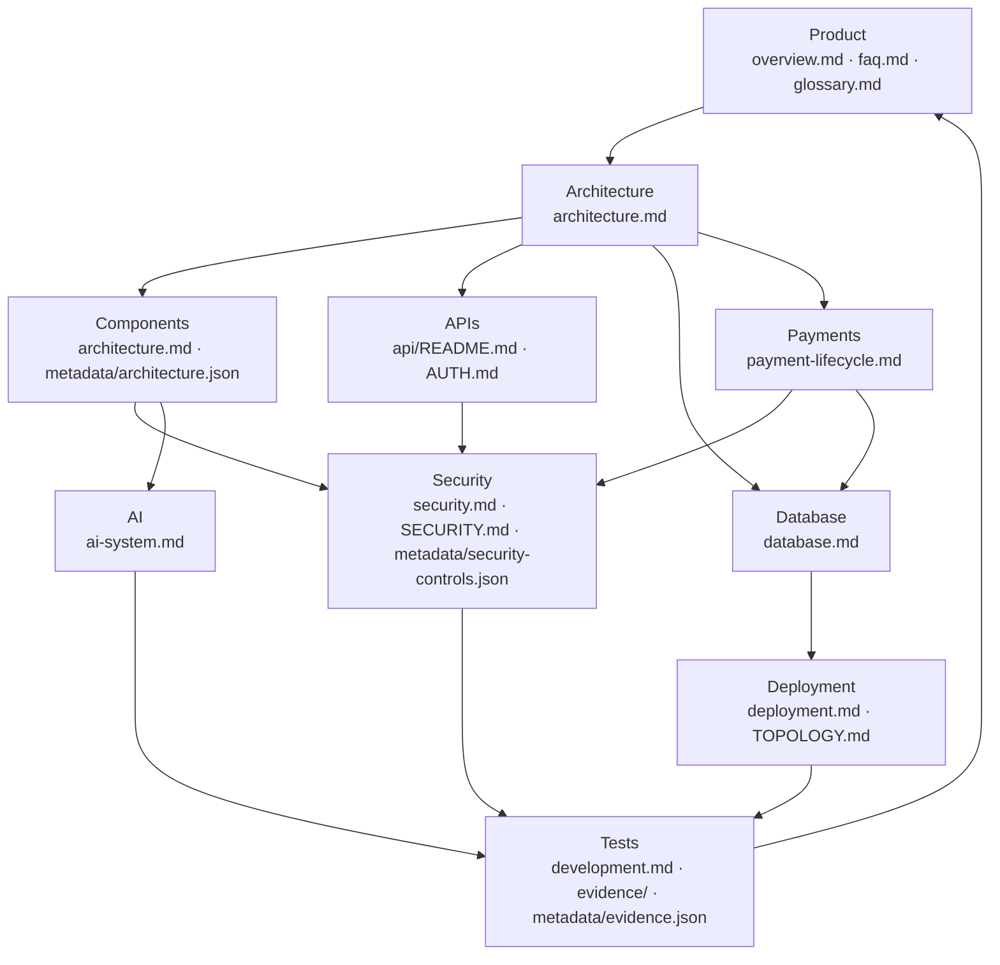

# PACT — knowledge map

A navigation map connecting the whole documentation set. Start anywhere; every node
links to the documents and code that expand it. If you reach a dead end, that is a
documentation bug — see [`README.md`](README.md).

## The map

## Product → Architecture → Components

| Start here | Then |
|---|---|
| [`overview.md`](overview.md) — what PACT is, who it serves, its boundaries | [`architecture.md`](architecture.md) — how it is built |
| [`faq.md`](faq.md) — grounded answers | [`glossary.md`](glossary.md) — terminology |
| [`architecture.md`](architecture.md) — system, frontend, backend | [`metadata/architecture.json`](../metadata/architecture.json) — component map |

## Components → APIs → Database

| Topic | Document |
|---|---|
| The HTTP surface | [`api/README.md`](api/README.md) |
| Authentication and roles | [`AUTH.md`](AUTH.md) |
| Schema, migrations, isolation, retention | [`database.md`](database.md) |
| Cross-instance safety | [`TOPOLOGY.md`](TOPOLOGY.md) |

## Payments

| Topic | Document |
|---|---|
| The full escrow lifecycle, stage by stage | [`payment-lifecycle.md`](payment-lifecycle.md) |
| Why the PayPal client is hand-written | [`architecture-decisions/0001-hand-written-paypal-client.md`](architecture-decisions/0001-hand-written-paypal-client.md) |
| Idempotency and duplicate handling | [`payment-lifecycle.md`](payment-lifecycle.md) (Stages 9–11) |

## Security

| Topic | Document |
|---|---|
| Controls and threat model | [`security.md`](security.md) |
| Reporting a vulnerability | [`SECURITY.md`](../SECURITY.md) |
| Machine-readable controls | [`metadata/security-controls.json`](../metadata/security-controls.json) |

## AI

| Topic | Document |
|---|---|
| The three AI roles and their boundaries | [`ai-system.md`](ai-system.md) |
| What the AI cannot do | [`ai-system.md`](ai-system.md#what-the-ai-does-not-do) |

## Tests and evidence

| Topic | Document |
|---|---|
| How to run everything | [`development.md`](development.md) |
| Test and deployment evidence | [`evidence/README.md`](evidence/README.md) |
| Machine-readable evidence | [`metadata/evidence.json`](../metadata/evidence.json) |
| What the demo does and does not prove | [`DEMO_EVIDENCE.md`](DEMO_EVIDENCE.md) |

## Deployment

| Topic | Document |
|---|---|
| Vercel, Postgres, environment, verification | [`deployment.md`](deployment.md) |
| Running a controlled beta | [`beta-operations.md`](beta-operations.md) |
| Multi-instance guarantees | [`TOPOLOGY.md`](TOPOLOGY.md) |

## Source-code entry points

| Concern | File |
|---|---|
| Application entry, middleware, startup checks | `backend/pact/main.py` |
| Configuration and runtime validation | `backend/pact/config.py` |
| HTTP routes (jobs, ledger, SSE, webhook) | `backend/pact/api/routes.py` |
| Authentication and authorization | `backend/pact/api/auth.py` |
| Customer/guest auth endpoints | `backend/pact/api/auth_routes.py` |
| Orchestrator | `backend/pact/core/engine.py` |
| Negotiation | `backend/pact/core/negotiation.py` |
| Verifier + settlement decisions | `backend/pact/core/settlement.py` |
| Domain models and the ledger | `backend/pact/core/models.py` |
| Filesystem persistence | `backend/pact/core/store.py` |
| PostgreSQL persistence | `backend/pact/core/dbstore.py` |
| Connection pool and direct endpoint | `backend/pact/core/pool.py` |
| Webhook application | `backend/pact/core/webhooks.py` |
| Webhook event registry | `backend/pact/core/webhook_store.py` |
| SSE ticket registry | `backend/pact/core/ticket_store.py` |
| Guest workspaces | `backend/pact/core/guests.py` |
| PayPal escrow client | `backend/pact/paypal/escrow.py` |
| PayPal mock double | `backend/pact/paypal/mock.py` |
| LLM access and fallback | `backend/pact/core/llm.py` |
| Seller agent | `backend/pact/agents/seller.py` |
| Frontend app | `frontend/src/App.jsx` |
| Frontend API client | `frontend/src/lib/api.js` |
| Frontend payment honesty | `frontend/src/lib/status.js` |

## Machine-readable index

- [`metadata/project.json`](../metadata/project.json)
- [`metadata/features.json`](../metadata/features.json)
- [`metadata/api.json`](../metadata/api.json)
- [`metadata/architecture.json`](../metadata/architecture.json)
- [`metadata/integrations.json`](../metadata/integrations.json)
- [`metadata/security-controls.json`](../metadata/security-controls.json)
- [`metadata/evidence.json`](../metadata/evidence.json)
